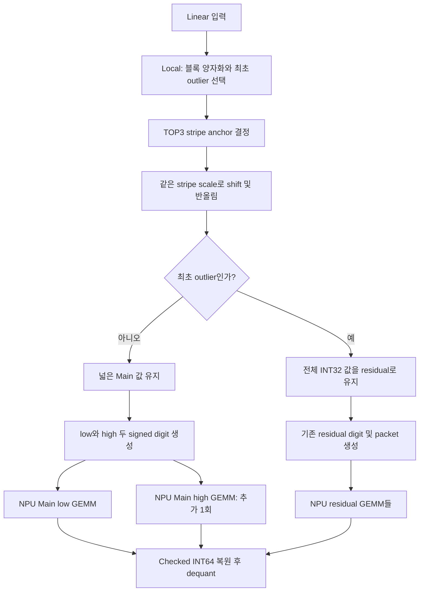

# PoTal: 최초 outlier 고정과 두 limb Main GEMM

## 핵심 아이디어

**Local 단계에서 선택한 outlier만 residual로 고정하고, stripe scale 정렬 때문에 커진 일반 값은 넓은 Main에 유지한다. 이 Main을 두 개의 저비트 limb로 나누어, 기존 Main GEMM에 추가 Main GEMM 1회를 더하는 방식으로 계산한다.**

기존에는 일반 값도 folding 후 커지면 residual 처리 대상이 되어 CPU에서 residual 분해, bitmap, index, packet 생성 작업이 늘어났다. 제안 방식은 이 값들의 상위 자릿수 계산을 규칙적인 dense Main GEMM으로 옮긴다. 목표는 추가 NPU 연산을 허용하면서 CPU의 불규칙한 residual 준비 비용을 줄이는 것이다.

여기서 **“프로모션 처리를 추가 Main limb GEMM 1회로 오프로딩한다”**는 말은, 승격된 값이 담당하던 곱셈을 추가 Main 경로가 담당한다는 뜻이다. Scale 선택, folding shift, Main digit 생성 자체는 여전히 CPU에서 수행한다. NPU가 outlier 선택이나 folding을 대신 수행하는 것은 아니다.

### 적용 범위와 상태

- 기준 소스: `potal`의 `53605451bcbd4ed9261e795b8bf9804ad3730de4`.
- 작업 브랜치: `feat/potal-prefold-main2-20261117`.
- 적용 대상: **Linear W4 → Main8, Linear W8 → Main16**.
- Attention의 QK·PV 양자화와 decomposition은 이번 변경 범위에 포함하지 않는다.
- 코어 역할 재분배나 새로운 멀티코어 최적화는 별도 작업이다.
- 공유 ExSIA folding과 `ggml-potal` / `ggml-potal-w4a4`의 실제 paired 명령 발행 경로에 구현했다. CUDA 대체 경로가 아니다. FPGA 보드 실험과 전체 모델 PPL·TTFT·TPOT 측정은 별도이다.

## 1. 용어와 scale

| 기호 | 의미 |
|---|---|
| `n` | NPU PE의 signed operand 폭: 4 또는 8 |
| `B_K` | Local 양자화 블록 크기. 이번 검사에서는 32 |
| `O[i,k]` | Local의 exponent preselection과 integer 2σ 판정으로 얻은 최초 outlier mask |
| `q[i,k]` | 블록의 최종 Local scale로 양자화한 INT32 중간 코드 |
| `e[i,b]` | Local 적응 이후 블록 지수 |
| `e_s` | stripe 안의 세 번째로 큰 서로 다른 유한 블록 지수인 TOP3 anchor. 지수가 부족하면 기존 fallback 적용 |
| `rho` | Linear에서 `n - 2` |
| `u[i,k]` | `q[i,k]`를 stripe scale로 정렬한 INT32 코드 |
| `R` | digit의 기수, `2^n` |

Local 표현과 folding 표현은 다음과 같다.

```text
x[i,k] ≈ 2^(e[i,b] - rho) * q[i,k]

delta[i,b] = e[i,b] - e_s
u[i,k]    = sat32(round(q[i,k] * 2^delta[i,b]))

x[i,k] ≈ 2^(e_s - rho) * u[i,k]
```

양수 delta는 left shift, 음수 delta는 반올림을 포함한 right shift이다. 기준 소스의 Local 양자화와 folding right shift는 ties-to-even이며, 이 변경 때문에 반올림 방식을 바꾸지 않는다.

대화에서 “첫 clipping에서 고른 값”이라고 부른 것은 여기서는 **최초 Local outlier mask**를 뜻한다. 단순히 `q`가 signed n-bit 범위를 벗어났는지 검사하는 것으로 대체하지 않는다. `q`는 이 시점에 INT32로 유지되며, 모든 값이 이미 n-bit로 잘려 있다는 가정도 하지 않는다.

## 2. 기존 방식: folding 중 residual 대상 확대

기존 보상 대상은 다음과 같다.

```text
E_old[i,k] = O[i,k] OR (e[i,b] > e_s)
```

즉 anchor보다 지수가 큰 블록은 원래 outlier가 아니던 위치도 보상 대상으로 승격한다. 다만 **보상 대상이라는 것과 실제 nonzero residual이 생긴다는 것은 다르다.** 정렬한 값이 n-bit 범위 안이면 residual 값은 0일 수 있다.

보상 대상 위치에서는 `u`를 signed n-bit Main의 low digit과 나머지 residual로 분리한다. 대상이 아닌 위치에서는 기존 n-bit clipping을 적용한다.

```text
Local: q, O, block exponent
  → stripe anchor 선택
  → q를 stripe scale로 shift/round
  → 위쪽 블록의 보상 mask 확대
  → Main low digit + residual 분리
  → residual digit·bitmap·index·packet 생성
  → NPU: Main GEMM + residual GEMM들
```

CPU 비용은 shift뿐 아니라 승격된 값들의 residual 분해 및 packet 구성에서 발생한다.

## 3. 제안 방식: 최초 선택을 고정하고 Main을 넓힘

### 3.1 Local 선택은 유지

기존 Local 단계의 지수 선택, integer 2σ 판정, Local 재양자화를 그대로 수행한다. 여기서 얻은 `O`를 이후에도 유지하며, folding 때문에 새로운 residual 위치를 추가하지 않는다.

### 3.2 Anchor 이후 같은 scale로 정렬

기존 TOP3 anchor로 `u`를 만든 다음 다음과 같이 경로를 분리한다.

```text
if O[i,k] == 0:
    MainWide[i,k] = u[i,k]
    Residual[i,k] = 0
else:
    MainWide[i,k] = 0
    Residual[i,k] = u[i,k]
```

최초 outlier는 **전체 값**을 residual로 보낸다. 기존 방식처럼 해당 outlier의 low digit 일부를 Main에 남기는 구조가 아니다. 따라서 이 outlier들의 residual에는 0번 digit도 필요할 수 있다.

Main과 residual 모두 `2^(e_s-rho)`의 동일한 streamed execution scale을 사용한다. Residual만 이전 block scale에 둔 채 더하지 않는다. Anchor가 확정되기 전에 residual을 NPU에서 먼저 실행하는 설계도 아니다.

### 3.3 Main을 두 signed digit으로 분해

Main의 유효 정밀도를 두 배로 잡되 NPU 입력 폭은 바꾸지 않는다.

| PE 폭 | 논리적 Main | NPU 입력 | Main 계산 |
|---|---|---|---|
| signed INT4 | Main8 | signed INT4 low / high | `C0 + 16*C1` |
| signed INT8 | Main16 | signed INT8 low / high | `C0 + 256*C1` |

표현 가능한 `u`에 대해:

```text
low  = ((u + R/2) mod R) - R/2
high = (u - low) / R
u    = low + R*high
```

`mod`는 음수에도 0부터 R−1까지 나오는 수학적 modulo이다. 구현에서는 unsigned 비트 연산으로 low를 구하고, `u-low`는 충분히 넓은 정수에서 계산한다. `high`는 정확한 정수이며 별도 반올림이 없다.

Folding shift와 두 digit 저장을 같은 순회에서 처리할 수 있다. 넓은 Main 전체를 저장한 다음 다시 읽어 분해하는 추가 패스는 알고리즘의 필수 조건이 아니다. 다만 어떤 저장 구현을 택하든 범위 검사를 먼저 해야 한다.

### 3.4 실제 NPU 실행과 복원

```text
C0 = GEMM(MainLow,  stationary weight)
C1 = GEMM(MainHigh, stationary weight)

R_l = GEMM(ResidualDigit_l, 해당 stationary weight)

Y_integer = C0 + 2^n*C1 + Σ_l 2^(n*l)*R_l
Y[i,j]    = 2^(e_s-rho+theta_W[j]) * Y_integer[i,j]
```

각 GEMM은 기존 stationary block carrier에 따른 partial-sum 정렬을 사용한다. 복원은 checked INT64로 수행하고 기존 출력 scale을 적용한다. Main의 high 결과를 INT32 accumulator 안에서 무조건 shift하여 합치는 것으로 대체하면 overflow 특성이 달라지므로 주의해야 한다.

**Main은 논리적으로 총 2회, 기존보다 1회 추가된다.** 이는 모델 전체에서 RoCC 명령이 단 한 번 늘어난다는 뜻이 아니다. 각 stripe와 J/K 타일에 맞는 명령, staging, DMA, readback이 추가된다. Residual GEMM 수는 최초 outlier의 digit 및 packing에 따라 달라진다.



## 4. 숫자로 보는 변화

아래의 최초 선택 여부는 이미 Local에서 결정했다고 가정한다.

| 상황 | 기존 방식 | 제안 방식 |
|---|---|---|
| W4, 최초 비-outlier, `q=7`, delta=2 → `u=28` | Main=−4, residual=32 | Main low=−4, high=2 → `−4+16*2=28`, residual 없음 |
| W8, 최초 비-outlier, `q=100`, delta=2 → `u=400` | Main=−112, residual=512 | Main low=−112, high=2 → `−112+256*2=400`, residual 없음 |
| W8, 최초 outlier, `u=200` | Main=−56, residual=256 | Main=0, residual 전체 200 → residual digit −56과 1 |

첫 두 경우는 원래 residual 경로가 처리하던 상위 자릿수를 추가 Main GEMM으로 옮긴다. 마지막 경우는 처음부터 선택된 outlier이므로 계속 residual로 처리하되, low digit도 residual에 포함된다.

## 5. 무엇이 줄고 무엇이 늘어나는가

| 항목 | 변화 |
|---|---|
| Local 지수 선택·2σ·재양자화 | 유지 |
| Stripe anchor 및 folding shift/round | 유지 |
| Anchor 초과 블록의 residual mask 승격 | 제거 |
| 승격된 일반 값의 sparse residual 준비 | 추가 dense Main digit으로 대체 |
| 최초 outlier의 residual 준비 | 유지. 전체 값을 처리하므로 low digit이 추가될 수 있음 |
| Main 버퍼·packing·GEMM·readback | 두 번째 digit에 해당하는 작업 증가 |
| Residual bitmap/index/packet | 승격 위치를 제외하는 효과가 있으나 실제 크기는 측정 필요 |
| CPU 최종 복원 | Main high 결과의 radix 합산 추가 |
| NPU PE와 INT32 accumulator 폭 | 기존 유지 |

Residual의 위치 수 감소가 곧바로 같은 비율의 limb 수, padded MAC 수, TTFT 감소를 뜻하지 않는다. 최초 outlier의 low digit 이동, DIM padding, tile 구성, 추가 Main readback까지 포함해야 한다.

## 6. 정확성 조건

### 두 signed digit의 표현 범위

두 signed n-bit digit이 표현하는 범위는 다음과 같다.

```text
minimum = -2^(n-1) * (2^n + 1)
maximum = (2^(n-1) - 1) * (2^n + 1)
```

| 구성 | 넓은 정수 저장 범위 | 두 signed digit 범위 | 두 조건을 모두 만족하는 범위 |
|---|---|---|---|
| W4 → Main8 | −128~127 | −136~119 | **−128~119** |
| W8 → Main16 | −32768~32767 | −32896~32639 | **−32768~32639** |

예를 들어 +127은 INT8에는 저장되지만 signed INT4 digit 두 개로는 표현할 수 없다. 구현은 범위 밖 값을 truncate하거나 clamp하지 않고 `[POTAL_MAIN2] range overflow`를 출력하며 해당 노드를 실패시킨다. 노드의 부분 결과는 출력 텐서에 반영하지 않는다. 앞선 stripe가 이미 실행됐을 수 있으므로, 전체 노드의 첫 명령 이전에 모든 범위를 확인하는 정책은 아니다.

TOP3는 지수 간격의 상한을 보장하지 않는다. `q=7`, delta=5이면 `u=224`이다. 지금의 실제 입력 검사에서는 발견되지 않았지만 이론적으로 배제되는 경우는 아니다.

### 기존 결과와의 동치 범위

- 두 digit으로 표현 가능한 비-outlier와 INT32 residual은, 복원 overflow가 없다면 각각 정렬된 코드 `u`를 정확히 표현한다.
- 이 방식은 Local 양자화나 folding right-shift의 반올림 손실을 복구하지 않는다. 원본 FP 직접 재양자화도 아니다.
- 기존 보상 대상에서는 shifter/accumulator 포화가 없는 정확한 정수 계산을 가정할 때 같은 `u`를 복원한다.
- 기존 보상 대상이 아니면서 n-bit clipping되던 값이 있다면, 새 Main은 그 값도 더 넓게 보존하므로 기존 결과와 달라질 수 있다.
- Main/residual 간 digit 배치가 바뀌면 각 INT32 부분합의 포화 발생 여부도 달라질 수 있다. 따라서 “분해식이 정확하므로 전체 PPL도 반드시 같다”는 주장은 하지 않는다.

## 7. 지금 확보된 검증 근거

### 실제 입력의 범위 검사

현재 `potal`의 Local 함수와 folding shift를 사용해 최초 mask가 0인 값만 검사했다.

| 입력 | 폭 | 최초 비-outlier 수 | Folding 후 범위 | 저장/두 digit 범위 초과 |
|---|---:|---:|---:|---:|
| Qwen FPGA W4 덤프 12개 | 4 | 3,044,962 | −32~32 | 0 / 0 |
| Qwen FP16 입력 replay 66개 | 4 | 2,793,143 | −28~32 | 0 / 0 |
| Llama FP16 입력 replay 66개 | 4 | 5,661,792 | −32~32 | 0 / 0 |
| Qwen FP16 입력 replay 66개 | 8 | 2,788,740 | −496~536 | 0 / 0 |
| Llama FP16 입력 replay 66개 | 8 | 5,655,260 | −496~500 | 0 / 0 |

FPGA 자료는 Qwen 512-token 실행의 일부 Linear 입력이다. FP16 replay는 128-token prefill + 2회 decode의 첫/중간/마지막 층 및 LM head 입력이며, W4/W8에 같은 입력을 재사용했다. 입력 공유로 같은 값이 여러 번 집계될 수 있다. 전체 모델·전체 데이터의 무초과 검증은 아니다.

### 기존 Nano 합성 실험

W8, M32/K4096/N128, 최초 선택 6.25%인 합성 입력에서 NPU용 준비 시간이
6.107→2.911 ms, 다른 shift 조건에서 6.864→2.918 ms로 줄었다. 감소율은 각각 52.3%, 57.5%이다.
이 실험은 이미 만들어진 INT32 Local 코드에서 시작했으며 실제 Local outlier 판정, planner,
DMA, RoCC 발행 및 NPU 실행을 포함하지 않았다. CPU-only 전체 계산은 추가 dense GEMM 비용 때문에 오히려 느려졌다.

따라서 위 수치는 **CPU residual 준비 감소 가능성의 근거**이며 FPGA TTFT/TPOT 개선율이 아니다.

로컬 근거 자료:

- `experiment-tools/main2-range-audit-20261117/REPORT.ko.md`: 실제 입력 범위 검사, 재현 스크립트와 CSV.
- `experiment-tools/prefold-selection-main16-20261116/REPORT.ko.md`: Nano 합성 입력 실험 및 포화 반례.

위 경로는 PoTal 프로젝트 상위 폴더 기준이며 이 Git 저장소에 포함된 파일은 아니다.

## 8. 이식·검증 체크포인트

1. Linear에만 활성화하고 Attention QK·PV의 기존 경로를 유지한다.
2. Local mask를 folding 중 승격으로 덮어쓰지 않는다. 최초 선택은 단순 n-bit 범위 검사로 대체하지 않는다.
3. 최초 outlier에서는 Main low/high를 모두 0으로 하고, 전체 `u`를 residual에 보낸다. Residual lane 0을 무조건 생략하지 않는다.
4. 비-outlier는 범위 확인 후 두 signed digit으로 저장한다. W4 packing에서도 signed nibble과 row stride를 검증한다.
5. Main low/high를 모두 실제 FPGA GEMM 경로로 발행하고 결과 버퍼를 완료까지 유지한다. CPU/CUDA 대체만으로 FPGA 지원 완료라고 하지 않는다.
6. 기존 tile별 shift·INT32 포화 규칙을 각각의 GEMM에 유지하고, radix 복원은 checked INT64로 수행한다.
7. 메인 high의 준비·명령·DMA·readback을 성능 계측에서 빠뜨리지 않는다. 기존과 새로운 방식의 같은 워크로드를 비교한다.
8. 준비 시간뿐 아니라 전체 TTFT, decode TPOT 중앙값, saturation 수, PPL을 확인한다. 새 멀티코어 최적화는 이 알고리즘 비교와 분리한다.

## 9. 구현 위치와 실행 방법

기존 FPGA용 W4 또는 W8 빌드에 다음 환경변수를 설정한다. 새 모드는 기본 OFF이다.

```sh
export GEMMINI_MATMUL_MODE=STRIPE_PIPELINE
export GEMMINI_RMD_BACKEND=WS
export GGML_POTAL_HART_ROLES=ON
export GGML_POTAL_STRICT_ISSUER=ON
export GGML_POTAL_PAIRED_AUTO=ON
export GGML_POTAL_LINEAR_MAIN2=1
```

빌드에는 ExSIA와 residual compensation이 활성화되어 있어야 한다. 기존 W4/W8 모델,
DIM, SDK 및 FPGA bitstream의 일치 조건은 그대로다. 지원하지 않는 실행 모드에서
Main2를 켜면 조용히 기존 알고리즘으로 돌아가지 않고 오류로 종료한다.
`GGML_POTAL_LINEAR_MAIN2=0` 또는 변수 미설정으로 기존 방식과 A/B 비교할 수 있다.

| 위치 | 역할 |
|---|---|
| `ggml/src/ggml-gemmini/quants/act/exsia/wide-main.hpp` | 범위 검사 및 정확한 두 signed digit 분해 |
| `ggml/src/ggml-gemmini/quants/act/exsia/folding.cpp` | 최초 mask 고정, 동일한 folding shift, Main low/high 및 전체 outlier residual 생성 |
| `ggml/src/ggml-gemmini/quants/act/exsia/exsia-event.hpp` | high digit 소유권을 stripe 작업에 전달 |
| `ggml/src/ggml-potal/matmul/stripe.cpp` | W8 low+residual 세션, high Main 세션, checked INT64 복원 |
| `ggml/src/ggml-potal-w4a4/matmul/stripe.cpp` | W4 signed nibble packing과 동일한 두 세션 실행 |
| `ggml/src/ggml-potal/tests/potal-main2-test.cpp` | 두 backend에서 공유하는 production pipeline/명령 에뮬레이터 검사 |

두 Main 작업의 plan과 DMA staging은 기존 준비 코어에서 READY 전에 생성한다.
발행 코어는 기존 paired runner로 low+residual을 완료한 뒤 high Main을 실행한다.
각 세션은 기존 fence/readback 규칙을 지키며, 마지막 복원 전까지 두 결과를 보존한다.
따라서 현재 구현은 두 Main 간 weight residency를 새로 공유하는 최적화가 아니고,
추가 Main의 weight 전송·명령 발행 비용도 발생한다. 기존 코어 역할은 바꾸지 않았다.

최종 복원은 `int64(C0) + 2^n*int64(C1) + residual`에 overflow 검사를 적용하고,
그 뒤 activation/channel scale을 곱한다. 수치 범위나 NPU 세션 실패 시 출력 commit을
취소한다. 새 low/high의 GEMM 수, 명령 수, readback 및 발행 시간은 pipeline 집계에
모두 포함된다.

### 2026-11-17 구현 검증

Ubuntu 24.04 WSL, GCC 13, Release, DIM32/BK32/TOP3, CUDA OFF로 W4/W8 backend를
각각 빌드했다. CPU의 H2 명령 에뮬레이터로 실제 `run_stripe_pipeline`과
`potal_paired_run_session`을 실행했으며, FPGA 보드에서 실행한 결과는 아니다.

| 검사 | 결과 |
|---|---|
| `potal-main2-test`, W4 | 10/10 시나리오 PASS |
| `potal-main2-test`, W8 | 10/10 시나리오 PASS |
| W4·W8 두 digit 표현 범위 전체 및 바로 바깥 값 | 정확한 복원 / 범위 거부 PASS |
| Decode 1행, prefill 67행, 슬롯 용량 1/2, 최초 outlier 유/무 | 실제 Main 세션 2회/stripe, scalar 내적과 출력 일치 |
| W4 값 224 / W8 값 57344의 Main 초과 | 첫 stripe 발행 전 거부, 출력 유지 |
| 두 번째 Main 세션 실패 주입 | 노드 실패, 부분 출력 commit 없음 |
| W4 `potal-w4a4-golden-test`, 새 모드 OFF | 기존 Linear·QK·PV 포함 39 cases PASS |
| W8 `potal-stripe-pipeline-test`, 새 모드 OFF | PASS |
| W8 `potal-residual-unit-test`, 새 모드 OFF | PASS |
| 별도 테스트 사본에서 high Main 결과를 0으로 훼손 | `exact scalar dot product` 검사가 실패하여 누락 탐지 |

재실행할 때 각 build 디렉터리에서 다음을 사용한다.

```sh
# W4
cmake --build build-w4 --target potal-main2-test potal-w4a4-golden-test
build-w4/bin/potal-main2-test
env -u GGML_POTAL_LINEAR_MAIN2 build-w4/bin/potal-w4a4-golden-test

# W8
cmake --build build-w8 --target potal-main2-test potal-stripe-pipeline-test potal-residual-unit-test
build-w8/bin/potal-main2-test
env -u GGML_POTAL_LINEAR_MAIN2 build-w8/bin/potal-stripe-pipeline-test
env -u GGML_POTAL_LINEAR_MAIN2 build-w8/bin/potal-residual-unit-test
```

`potal-main2-test`는 Linux host에서 접근 가능한 CPU 5개를 테스트 역할에 매핑한다.
에뮬레이터는 실제 Rocket 코어, DMA 지연, FPGA timing을 대신 인증하지 않는다.
RISC-V cross build, FPGA 실행, 새 알고리즘의 전체 PPL 및 TTFT/TPOT는 아직 측정하지 않았다.

보고에 사용할 표현:

> 최초 Local outlier 선택을 고정하고, stripe 정렬로 커진 비-outlier 값을 두 digit의 Main 표현에 유지했다. 기존 residual 승격 경로의 상위 자릿수 연산을 추가 Main limb GEMM 1회로 옮겨 CPU의 residual 분해·packing 부담을 줄이는 설계이다. 추가 dense GEMM 및 복원 비용과의 손익은 전체 실행으로 평가한다.
